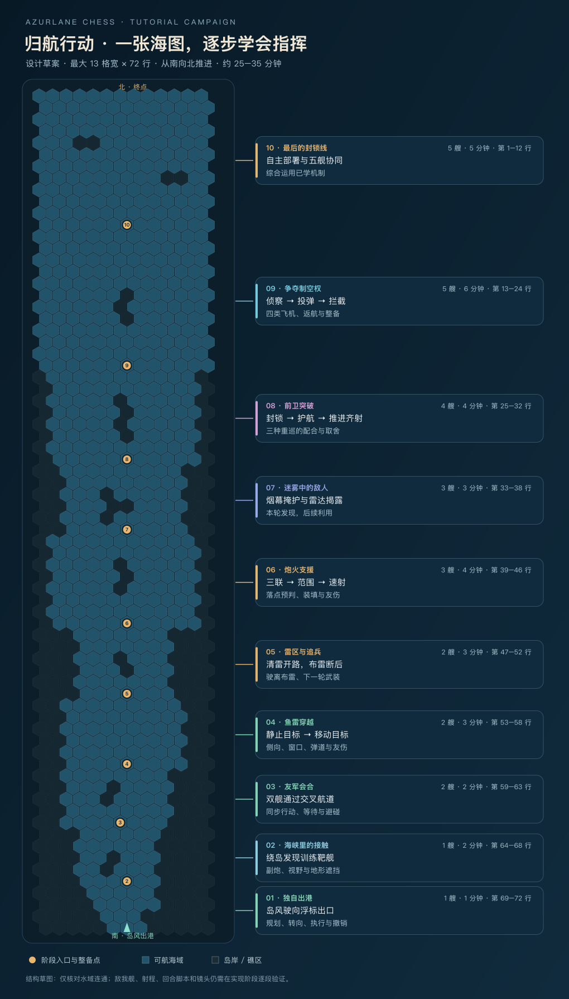

# 归航行动：连续教学战役设计稿

日期：2026-10-14  
状态：整体流程与固定窄长地图方向已获用户认可；本稿待用户评审，尚未开始实现。  
代码基线：v0.5.11。此次仅产出设计材料，不运行版本递增。

## 1. 目标与已确认约束

- 新玩家从真实的一艘己方舰船开始，通过连续实战逐步学会操作、战斗规则及 15 艘舰船的核心能力。
- 首次通关目标为 25–35 分钟，可以中途退出并继续；目标时长需要新手试玩验证。
- 使用一张固定、手工设计、从南向北推进的窄长海图。岛岸结构贯穿全程，十段任务依次展开。
- 教学允许专用数值、低耐久靶舰、预告航线和固定敌方行动。特殊数值应明确标注为训练参数。
- 正常对局地图尺寸、编队准备、选禁流程与回合设置沿用现状。
- 本阶段讨论并固化设计，不修改游戏代码。15 舰能力以当前实际配置为准，不回退到前期草案数值。
- 当前已记录的通用 UI 优化、操作便利性及友军碰撞警告仍在项目 TODO；本设计只规定新教学需要的引导表现。

## 2. 整体体验

玩家以岛风开始“归航行动”，沿途会合训练支队，从一艘舰逐步增加到五艘。每段先安排安全尝试，再加入一个变化，最后要求一次自主运用。阶段完成后出现“继续航行”，镜头与舰队沿固定海图向北推进。

十段任务以剧情与地图串联。章节完成不要求回到课程菜单重新选课。每段内部可以有多个短练习，并以检查点隔开。

阶段入口负责增援、支队换舰与补给。同类舰船在专门练习中接替出场，换舰明确显示名称与核心差异，不把一艘舰的能力静默改成另一艘。场上可控己方舰始终不超过五艘。

## 3. 固定地图

### 3.1 尺寸与形状

本稿按最大 13 列、72 行六角格设计，共 936 格，从第 72 行向第 1 行推进。13 格是地图矩形的最大宽度；南端可航航道为 3–5 格，之后以海湾和岛间通道逐步展开，航空和终章可用到 13 格宽。

地图不是要求玩家逐格驶完的长途行军。主动操作集中在每段任务水域。完成任务后的安全航渡由教程执行短暂过场，随后进入下一段入口阵位，不消耗正式战斗回合。岛岸位置保持连续，镜头可以沿海图展示这段航渡。

地图草图表达固定地形与阶段范围。已核对草图所有水格连通、各阶段入口与出口位于同一可达水域；还未验证带航向的舰船路线、实际敌我摆位与武器交互。实现时应在本稿分区内完成这些验证，并调整局部礁区，保持整体结构与教学顺序。

### 3.2 分区表

下表行号为玩家可读的 1 起始行号；内部六角坐标仍使用 0 起始。

| 段 | 海图行号 | 水域构形 | 己方舰数 | 目标时间 |
|---|---|---|---:|---:|
| 1 独自出港 | 69–72 | 3–5 格宽出港航道，小转弯空间 | 1 | 1 分钟 |
| 2 海峡里的接触 | 64–68 | 岛屿遮挡的双侧绕行通道 | 1 | 2 分钟 |
| 3 友军会合 | 59–63 | 两条汇入航道和交叉点 | 2 | 2 分钟 |
| 4 鱼雷穿越 | 53–58 | 有横向空间的雷击靶场 | 2 | 3 分钟 |
| 5 雷区与追兵 | 47–52 | 分岔雷区和断后通道 | 2 | 3 分钟 |
| 6 炮火支援 | 39–46 | 隔岛炮击区、移动靶线与密集靶区 | 3 | 4 分钟 |
| 7 迷雾中的敌人 | 33–38 | 带遮挡的烟幕湾 | 3 | 3 分钟 |
| 8 前卫突破 | 25–32 | 窄口与侧翼并存的重巡演练区 | 4 | 4 分钟 |
| 9 争夺制空权 | 13–24 | 纵深较大的航空湾和防空节点 | 5 | 6 分钟 |
| 10 最后的封锁线 | 1–12 | 有掩体与多条进攻路线的终章海域 | 5 | 5 分钟 |

设计目标总计约 33 分钟，包含正常提示与短过场。不存在要求玩家赶时间的倒计时。

### 3.3 分段启用与远程武器

- 后续章节的训练目标在相应阶段才入场，不提前作为可被攻击的战斗实体存在。
- 已知地形仍遵守正常探索规则，不为隐藏关卡而伪造视野或让已探索地形失忆。
- 当前阶段完成由任务条件判断；提前驶向下一段不会绕过当前任务。
- 当前目标、集合点和“继续航行”入口明确标示；玩家偏航时可使用定位当前任务或恢复检查点。
- 进入下一阶段前，本段演练先结束。由明确的整备过场清理遗留鱼雷、飞机、技能区域和教学布雷，再建立下一段局面。
- 跨段清理属于章节整备规则，不在正常回合中让已发射武器无提示消失。
- 同一段内部保留正常弹药、冷却和持续状态。只有明确的补给检查点才恢复资源，避免掩盖资源机制。

### 3.4 镜头与可读性

镜头默认框住当前任务区域及必要缓冲区；进入新段后平滑跟进。长图总览显示整条航线及阶段进度，点击已解锁节点可定位。地图自动跟进期间不替玩家下战斗指令；手动拖动后提供“返回任务”按钮。

手机默认显示当前水域，目标卡与指令面板可收起。暂停规划时可以浏览全图；回放仍可快进。章节过场支持跳过，跳过与完整观看得到相同稳定局面。

## 4. 十段任务

### 4.1 独自出港

- 己方只存在岛风一艘，不把额外友舰放在远处充数。没有敌舰。
- 首次自动选中岛风，突出航线、转向、撤销和执行。
- 先到正前方浮标，再到侧前方浮标，最后通过小转弯驶到出口。
- 首次动作给具体指引，之后接受任意合法到达路线，不要求精确复刻预设坐标序列。
- 结果：能独立写入计划、执行，并理解一次转向前进和原地转向都占步骤。

### 4.2 海峡里的接触

- 岛风绕岛接近 1 HP、无攻击能力的“训练靶舰”，由自动副炮击沉。
- 第二个目标沿固定路线进入岛后，展示发现、失去接触和地形记忆。
- 小挑战要求再次取得接触并完成击沉；可绕任一侧。
- 结果：理解当前可见、曾经看见和未知地形的区别，以及副炮的射程和遮挡要求。

### 4.3 友军会合

- 克利夫兰加入，玩家可控舰数增至两艘。
- 两舰从不同方向驶向集合区，航速不同；玩家通过等待或改路避免交叉相撞。
- 碰撞不是强制通关条件；发生时解释碰撞原因，并可回检查点重试。
- 后半段让两艘低耐久靶舰进入克利夫兰射程，观察它对两个不同目标分火。
- 结果：会切换舰船、查看全舰计划，理解同步行动、友军碰撞与共享视野。

### 4.4 鱼雷穿越

- 先以起点窗口侧向发射一枚鱼雷命中静止目标。
- 再用预告航线的移动目标学习后续节点发射和时机差异。
- 加入另一条可能路线与友舰位置，让玩家使用岛风的同窗多方向发射，同时检查友伤。
- 使用 v0.5.11 的岛风配置：每轮最多四枚、每窗最多四个合法不同方向，不能沿用旧教程的每窗一枚限制。
- 保留鱼雷跨回合航行，至少有一段让玩家看见前轮鱼雷继续前进。
- 结果：理解发射位置、侧向、窗口、有限弹药、持续航程与友伤。

### 4.5 雷区与追兵

- 整备点由 Z35 接替岛风，克利夫兰继续同行。
- 先用接触排雷开路，再由克利夫兰远程清雷，观察副炮机会被占用。
- 指定实际前进步骤，在驶离格布设水雷；Z35 使用当前六枚库存、每轮两枚的配置。
- 一轮中观察“未武装”，下一轮让按固定路线行驶的追兵触雷。
- 未到达布雷节点不扣库存；不以直接修改目标 HP 的方式伪造水雷命中。
- 结果：理解清雷方式的取舍、布雷位置及下一轮武装。

### 4.6 炮火支援

- 战列加入，舰数增至三艘。北卡、武藏、黎塞留在内部补给检查点依次接替同一战列席位；离开本段时北卡同行。
- 北卡：先单发击沉低耐久目标，再通过三发叠点处理较高耐久目标，经历一次真实装填空窗。装填期间有安全移动或观察任务。
- 武藏：攻击密集靶群，实际展示中心 120、邻格 60 的七格范围，同时保留友军危险位置供判断。
- 黎塞留：连续两个回合攻击移动目标，展示每轮两发、单发 40、无需空过装填回合。
- 从预告移动路线过渡到玩家根据上一轮行动自行判断。
- 结果：理解回合初射程、回合末落点、不同主炮配置、预判、盲射与友伤。

### 4.7 迷雾中的敌人

- 阿卡司塔与海伦娜分别接替驱逐、轻巡席位，北卡继续同行。
- 先使用烟幕掩护通过敌方观察区，观察烟幕内外视野变化和两轮持续时间。
- 再面对敌方烟幕，用海伦娜雷达取得接触；新信息用于下一回合瞄准或锁定。
- 雷达揭露不消除副炮所需的地形视线条件，也不允许在执行中修改已提交指令。
- 任务面板显示烟幕与雷达剩余次数，显示使用雷达占用副炮的取舍。
- 结果：理解临时隐蔽、反隐、共享信息及有限次数技能。

### 4.8 前卫突破

- 重巡加入，舰数增至四艘。欧根、巴尔的摩、旧金山依次接替重巡席位，离开本段时欧根同行。
- 欧根：截停移动靶，并以预告来袭鱼雷/炮击展示自身减伤；按当前配置包括鱼雷减伤和火炮减伤。
- 巴尔的摩：与需保护的友舰保持邻接，观察主炮或航空伤害减少，以及开启护航后只允许一步移动。
- 旧金山：让一个目标需要两发副炮才能击沉，通过实际完成两次前进触发移动结束后的齐射。
- 三个小段各有检查点，不在同一时刻要求新手理解三种能力。
- 结果：理解固定敌人、保护队友和机动进攻三种重巡用法。

### 4.9 争夺制空权

- 航母加入，舰数达到五艘。至少设置“航空基础”和“制空与反制”两个内部检查点。
- 香格里拉：先使用侦察机发现远处目标，再使用普通轰炸机完成成功空袭。
- 观察飞机按起飞位置和目标点决定的直线飞行、向当前母舰返航、累计航程和真实整备时间。飞机出击后让母舰移动一次。
- 圣地亚哥临时接替轻巡席位，拦截预告路线的敌机，展示内外两层防空。
- 埃塞克斯接替航母席位，使用战斗机巡逻完成一次实际空战拦截；展示不同机型共享每轮两个放飞名额。
- 企业接替航母席位，展示 3 HP 强袭机、35 伤害和两轮整备，与普通轰炸机形成比较。
- 不要求为通关故意损失飞机；损失发生时说明来源，并允许重试当前检查点。
- 结果：亲手完成侦察、投弹和拦截，理解四类飞机、母舰安全、防空与整备。

### 4.10 最后的封锁线

- 推荐编队为岛风、海伦娜、欧根、北卡、香格里拉，允许从已体验舰船中换成其他合法 3 前排＋2 后排编队。
- 此时才正式介绍五舰部署与前后排配额；教学开局不会先让玩家处理完整编队流程。
- 敌方五舰使用明确标注的训练耐久：正式最大耐久的 60%，四舍五入；舰种武器与运动规则维持正式数值。
- 敌方使用只读取己方视野的本地战术逻辑，避免读取玩家私密计划。早期预告路线的靶舰仍属于前面章节的专用脚本。
- 主任务为击败敌方舰队，不指定固定技能顺序，允许不同合法战术通关。
- 结算后只根据实际发生的战斗给出两三条反馈，并说明正式对局的全灭、回合上限和舰数/HP 比较规则。
- 结果：能自己完成部署、全舰规划和至少一次协同攻击。

## 5. 机制覆盖与引导方式

十五艘舰船都在战役中实际出场，每种核心特色至少有一次可操作的专门场景。入门单位只露出当前需要的操作，其余能力随教程推进开放；已学操作保持可用，不靠限制合法解法强迫玩家照抄。

需要计入教学覆盖的机制包括：
- 规划与执行、转向与等待、撤销/重做、同步移动、碰撞与原路回退。
- 当前视野、探索记忆、岛屿遮挡、己方共享视野。
- 普通/分火副炮、鱼雷窗口/侧向/寿命/友伤、主炮预判/装填/叠点/范围/速射。
- 接触排雷、远程排雷、布雷与武装时间。
- 烟幕、雷达、封锁、护航、推进齐射。
- 四类飞机、定点/指定目标、巡逻、防空/空战、返航/整备、有限机库。
- 正式编队与部署、战斗胜负、保存/继续教学。

关键任务以实际结果通过，例如取得接触、成功布雷、护航减伤生效、飞机回收。按钮点击只是指令输入，不单独替代结果验证。

提示按“任务意图 → 相关机制 → 操作建议”分级展开。玩家主动请求或连续几次未取得进展时，先给机制提示；再请求时提供参考路线。参考路线以当前已知局面计算，不泄露正式迷雾信息。

稀有边界规则可在相关事件发生时解释，不强制安排搁浅全灭、母舰沉没等所有负面结果。通关目标是掌握作战机制，不是背诵每个数值与异常情况。

## 6. 教学数值与失败恢复

- 入门静止/移动靶舰为 1 HP、无主动攻击；保持正常命中与伤害结算。
- 展示叠点、两发副炮等机制的目标按教学阈值设置耐久，并标注“训练参数”。
- 己方默认使用正式舰船属性。必要的任务补给发生在明确的检查点，不暗中给无敌或回满血。
- 普通交战阶段可调敌方耐久或指令节奏；不把概率必中的假命中混入正式物理。
- 关键目标提前被其他武器击沉、必须使用的弹药耗尽、必要舰船沉没时，提供当前小段重试或补练入口；不会让阶段永久卡住。
- 重试恢复当前检查点的单位、资源、任务标记及探索快照，已完成的前段进度不丢失。
- 第一段允许完全没有敌舰。任务控制器负责章节完成与失败，不用无关远处敌舰维持战斗。
- 章节前九段不套用正式全灭/30 回合结束规则；仍使用真实局部回合推进冷却、寿命与技能持续时间。终章使用正常舰队胜负判定。

## 7. 连续性与保存

地图坐标与岛岸固定；任务状态由阶段、检查点、已体验机制、解锁舰船及当前战斗快照组成。

稳定规划状态、已完成回合与检查点切换时保存教程；刷新后回到最后稳定状态，不恢复一半动画。章节换舰/补给只应用一次，重复加载不会多给弹药、重复生成增援或跳过任务。

教程使用独立的带内容版本的保存记录，不改写普通本地对局或联机状态。内容版本不兼容时保留已完成阶段，并从该阶段的安全入口重新开始，界面说明发生了重置。

退出时保留教学进度，普通对局可继续。全程无需连接服务器或调用在线模型。

## 8. 实现边界与现有代码约束

当前版本的地图边界、格子枚举、部分范围/点选和普通存档校验依赖 19×15 常量。实现长图必须让需要地图尺寸的运算读取当前地图上下文，并为普通对局保留原有默认值，不能只修改显示层宽高。

建议职责：
- 教学内容：固定地图、阶段定义、训练数值、敌方脚本、提示与任务条件。
- 战役控制：阶段/检查点状态、换舰补给、稳定存档、教学完成与失败判定。
- 战斗引擎：继续负责真实移动、碰撞、武器、视野与伤害，允许明确选择教学章节结束策略。
- 引导界面：当前任务、分级提示、检查点恢复、阶段进度、训练参数标识与镜头跟随。
- 战斗证据：由状态差分和结构化战斗结果判定机制，不把中文日志文案当作可靠的唯一接口。

新增教学保存应校验该固定地图与教学内容版本，普通 19×15 存档和已有 localStorage 键保留原规则。联机仍使用正式地图与原有战斗流程。

当前独立教程仍以旧通用模板为主。新战役必须使用实际 15 舰目录配置；旧教程可继续作为专项训练入口，涉及冲突数值的说明在实现时同步校正。

## 9. 验收要求

1. 新开教学实际只有一艘己方舰，纯航行段可正常执行多轮。
2. 每段安全试用和后续自主目标均可在真实结算中完成，至少接受一种非推荐路线。
3. 十五艘舰核心能力均有覆盖，不把旧鱼雷/飞机参数写进新教程。
4. 固定长图的边界、寻路、视野、点选、弹道、摄像机和保存一致；普通对局保持 19×15。
5. 未来任务实体不会被提前击沉；完成前越过阶段区域不会跳过任务。
6. 暂停、刷新、返回主页、重试和跳过过场不重复应用奖励或造成阶段错位。
7. 普通本地存档与在线对局不被教程覆盖。
8. 关键目标提前消失、关键舰沉没、弹药用尽时有明确恢复路径。
9. 桌面和手机实测可读、可点选，地图不会默认缩成无法辨识的整条细线。
10. 新手试玩的主要耗时用于学习与决策；按 25–35 分钟目标调整空航渡、说明长度和重复练习，不随意加速正式战斗规则。

## 10. 本次设计证据与下一步

- 已检查现有教程状态、任务条件、回放接入、舰船定义、地图边界与普通存档约束。
- 已绘制固定地图结构草图，确认示意水域连通及十段入口/出口的静态可达性；这不等于已完成战斗可玩性验证。
- 未修改游戏实现，未运行构建、战斗测试或版本递增。
- 用户评审本稿后，再制定实施计划；实施完成的新改动批次按项目约定推进一次版本。

