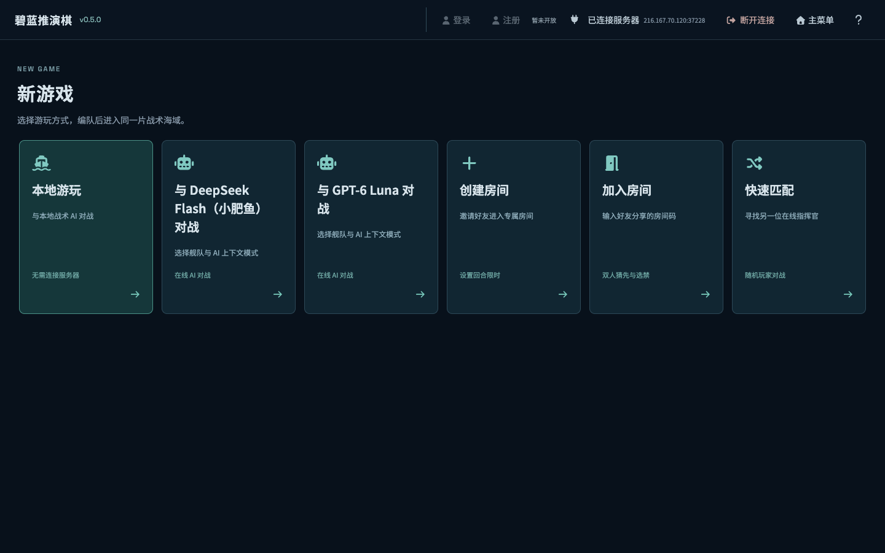
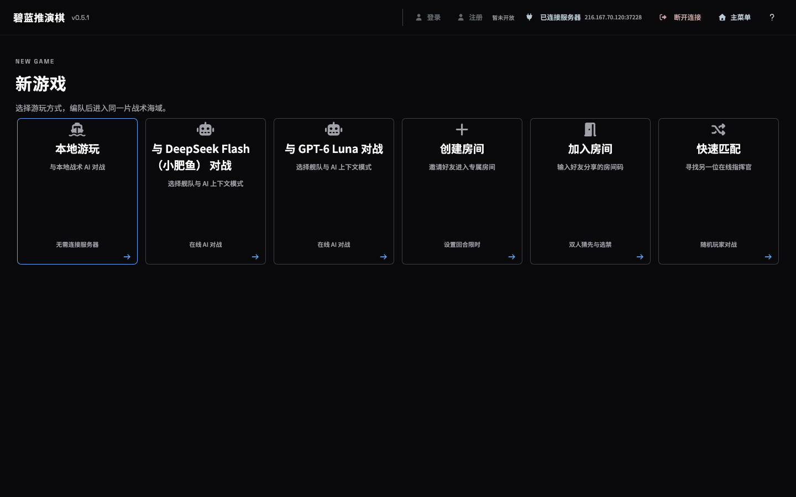
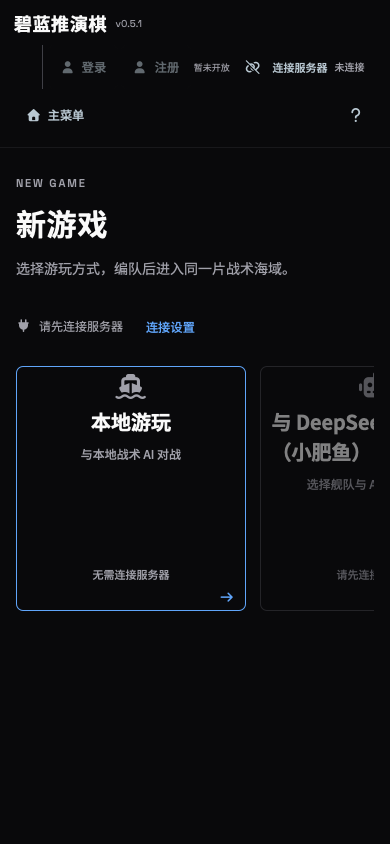

# v0.5.1 实施与验收记录

验收日期：2026-10-05。发布地址：http://216.167.70.120:37228/new。
本批版本仅推进一次至 v0.5.1，未提交或推送 Git；既有未提交源码、美术资源和未跟踪文件均保留。

## 实施及审查取舍

- 产品界面迁移为 Vue SFC 与 TypeScript，页面按路由加载；六个 Pinia store 分别管理连接、账号、本地战局、在线战局、教学及界面偏好。表单和地图运行实例保持局部状态，在线与本地草稿相互隔离。
- 原集中会话控制器拆为初始化入口及连接、存档、教学、规划、回放、地图 composable。保留原路由、协议版本、存档格式和存储键。
- 通用控件采用 shadcn-vue / Reka UI，应用深色 Zinc 与蓝色强调色；弹层、确认框、选择器、进度条等由成熟组件处理。业务编队、地图、选禁和指令编辑继续保留专用组件；图标统一使用 Font Awesome Free。
- 前端、引擎、渲染、服务器、Worker、测试全部启用严格 TypeScript 检查。共享类型明确区分完整服务器状态与迷雾过滤 DTO；外部数据作为 unknown，通过 TypeBox 校验后进入业务规则验证。
- 本地 AI 规划和结算通过 Comlink Worker 执行；防止重复提交、超时和跨会话旧结果覆盖。退出战场释放 Worker 和地图资源，继续对局保留草稿。
- 服务器采用 Piscina 复用线程，保留并发限制、200 项队列和默认 30 秒运行超时。HTTP 跨域和限流采用 Fastify 官方插件；只信任本机反向代理，WebSocket 消息按顺序处理。
- 服务器生产运行独立编译后的 ESM；AI 请求取消、响应大小限制、用量日志、上下文摘要、账号与 SQLite 机制保持原有行为。
- 一次独立最终代码审查完成，无有证据的 P0–P2 问题。

## 验证结果

| 范围 | 结果 |
|---|---|
| Node 25 全栈严格类型检查 | 通过，包括测试与 SFC |
| 本机完整测试 | 54 个文件，312/312 通过；最后仅改动的受控取消夹具另经 2/2 验证 |
| Linux 候选完整测试 | 最终 54 个文件，312/312 通过 |
| 本机与服务器生产构建 | 前端与独立 Node 产物均通过 |
| 计算确定性 | 三个种子与迁移前结果逐字段一致；服务器线程与直接结算一致，线程复用和关停通过 |
| 浏览器 | Chromium 桌面、WebKit 桌面及 390×844 手机通过；无页面运行错误 |
| 回归 | 完整回放、迷雾鱼雷、菜单继续、草稿隔离、教学、存档兼容、地图与 Worker 释放通过 |
| 联机与基础设施 | 双访客房间及选禁、队列取消、连接记忆、认输取消/退出、CORS、限流、代理边界及 WebSocket 顺序通过 |
| 发布路径 | 16 个深层 HTML 地址正常；5 类缺失 API / WebSocket / 静态资源保持 404 |

Linux 首轮只有一个测试失败：夹具假设任务在 60 ms 内仍处于等待，而服务器较慢，界面刷新已超过该时间。已改为受控 Promise，在退出后显式送达旧结果，验证其不能覆盖当前会话；生产代码没有因此改变。

## 性能与内存

三个相同种子、相同指令的独立结算对比：

| 指标 | 原主线程同步计算 | 当前 Worker |
|---|---:|---:|
| 总耗时 | 24.5–39.7 ms | 38.5–44.5 ms |
| 计算期间主线程心跳 | 0 次 | 12–14 次 |
| 最大主线程心跳间隔 | 24.9–40.4 ms | 4.6–4.7 ms |

Worker 有通信成本，单轮总耗时略增，但计算期间界面能响应。包含地图绘制的实际 UI 测试为 89.4 ms，期间 14 次心跳，最大间隔 22.8 ms。以上为本机小样本，不能替代长期性能监控。

本次未复现持续内存增长：Node 25 类型检查单进程峰值约 1.13 GiB，测试约 523 MiB，构建约 971 MiB，均正常退出；Node 26 与 Node 25 的同组类型检查占用接近。服务器候选人为设置 768 MiB 堆上限时类型检查触顶，调整至 1024 MiB 后通过。重任务保持串行，避免内存叠加。

发布后服务 PID 695127，服务单元当前内存约 72 MiB、峰值约 105 MiB；这是本次验收观察值，不构成长期无泄漏证明。临时本地服务和服务器候选服务已关闭，无本次类型检查或测试进程残留。

构建仍有大分块提示：主包约 722 KB（gzip 222 KB），战场分块约 577 KB（gzip 151 KB）；地图资源已按战场加载。

## 公网真实 AI 回合

两家模型各完成一个普通模式回合，无首轮重试；移动回放均为 33 帧，选中舰船有 9 个不同位置，进度采样记录 226 个变化值。返回菜单、继续、刷新恢复、认输断开全部通过。

| 模型 | API 请求耗时 | 从执行到收到回合结果 | 输入 / 输出 token |
|---|---:|---:|---:|
| GPT-6 Luna（fast） | 4.305 s | 5.243 s | 4692 / 435 |
| DeepSeek Flash | 5.410 s | 6.157 s | 4049 / 1232 |

耗时仅代表本次一回合样本，受到网络、模型和当时负载影响。服务器会预先规划下一回合：退出时 Luna 的第二轮请求被取消，DeepSeek 第二轮预规划已完成。日志保留这些尝试及用量，未复制密钥、完整上下文或模型正文。响应未提供价格字段，因此没有推算账单金额。

## 发布与回退

当前 release：`/opt/azurlane-chess/releases/v0.5.1-20261005-01`。
服务入口：`dist-server/server/index.js`。Nginx 端口、公开地址、私有 env、模型配置及数据库保持不变；校验了私有文件 SHA 与数据库 inode。

旧 release `/opt/azurlane-chess/releases/v0.5.0-20261005-01` 保留。回退需停止服务、移除本批 `30-compiled-service.conf` 启动覆盖、将 current 链接恢复至旧 release、重新载入 systemd 后启动；发布脚本已具备切换失败自动回退。

本次详细日志和结构化浏览器结果位于 `/tmp/azurlane-foundation-v051/`，恢复状态账本位于被忽略的 `docs/superpowers/.task-state.md`。

## 界面对比

v0.5.0 桌面：

v0.5.1 桌面：

v0.5.1 手机与连接弹层：

