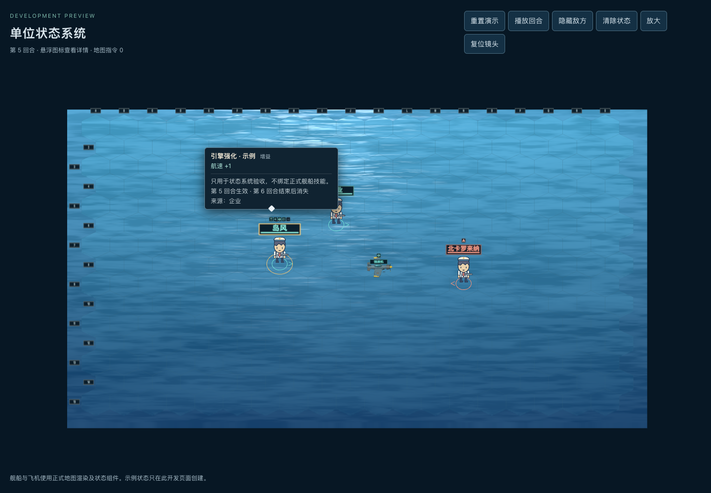
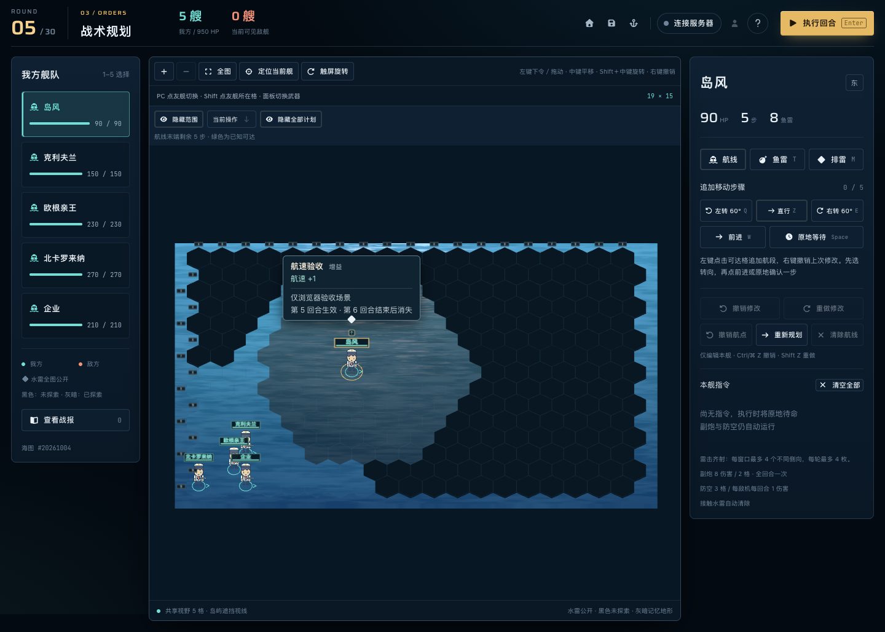
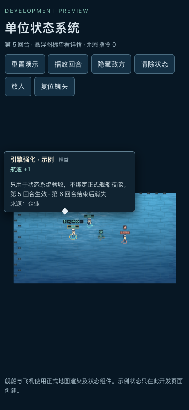

# v0.6.6 状态系统一期验收

本批实现舰船与飞机的状态核心、有效属性/伤害计算、生命周期、存档与网络/回放支持，以及名称上方状态图标和 Tooltip。正式玩法未添加自动施加状态的触发器。

## 自动验证

- `npm test`：99 个文件、544 项测试全部通过。日志 `/private/tmp/status-full-final.log`。
- `npm run typecheck`：前端与服务端通过。日志 `/private/tmp/status-typecheck-final.log`。
- `npm run build`：前端与服务端构建成功；保留既有大分块提示。日志 `/private/tmp/status-build-final.log`。
- `git diff --check` 通过；契约已重新生成；普通/教学存档版本及键保持不变。
- 无状态确定性基线保持原哈希；状态增速、周期伤害先于治疗/判胜、弹药快照、飞机独立效果、AI指令约束、来源过滤及保存往返均有专项测试。

初始受限环境中的联机/资产测试被本地监听 `EPERM` 阻断；在允许本机 HTTP/WebSocket 的环境重跑后全部通过。测试不连接真实云桶或模型服务。

## 独立审查

独立只读审查发现的5项P2均已修复并以失败→通过的回归验证：

1. 执行期满层替换保留本轮旧层，新层下一轮才接替。
2. `applyBattleStatus` 在施加时记录飞机的母舰归属，飞机回收后持续伤害仍正确归属。
3. 战绩累加支持新增状态伤害类别，账户明细显示对应标签。
4. 状态图标和 Tooltip 拦截键盘冒泡，Enter/Space 不误触战斗快捷键。
5. 普通及教学存档接受合法增伤生成的鱼雷/水雷伤害快照，基础配置校验仍保持原约束。

## 真实浏览器

使用现有 Playwright 与本机 Chrome（Browser plugin not available），桌面1440×1000和触屏390×844：

- 状态图标、具体效果、绝对期限、叠层、4个图标加溢出列表正确。
- 平移、旋转和缩放后图标继续跟随名称；命中区域不随缩放变小。
- Tooltip支持悬浮、键盘、触屏点击开关和外部关闭，手机上没有越出视口。
- 隐藏敌方、清空状态、回合播放与到期均移除对应图标和提示；隐藏来源不出现。
- 正式BattlePage载入状态测试存档，真实Comlink Worker执行5步航线，返回正确位置及回合5的状态快照。
- 正式BattlePage聚焦图标按Enter/Space后仍停在规划期，航线为0/5，没有提交回合或添加移动。
- 页面运行错误为空；开发演示页完整流程控制台错误为空。

证据日志：`/private/tmp/status-full-browser.log`、`/private/tmp/status-mobile-toggle.log`、`/private/tmp/status-battle-browser.log`。

## 用户追加的尺寸调整

交付前按用户要求将状态图标及外框整体宽高缩至原来的1/3：图案6×6px，外框8×8px，Tooltip保持可读尺寸。已重新通过桌面/触屏、相机与回放交互检查及生产构建，版本仍为v0.6.6。日志：`/private/tmp/status-small-browser.log`、`/private/tmp/status-battle-small.log`、`/private/tmp/status-build-small.log`。

## 版本与交付

并行历史战斗设计批次先将版本推进至v0.6.5，本批只执行一次版本递增至v0.6.6。package、锁文件、页面版本、HTML和README已同步。

开发入口为 `/tools/status-preview.html`，该示例未进入生产构建。接入说明见 [状态系统说明](../STATUS-SYSTEM.md)。未提交、推送或部署。
